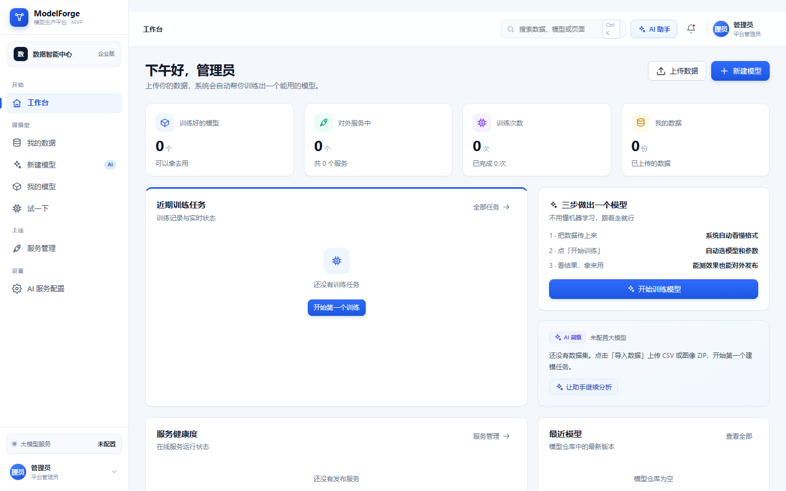
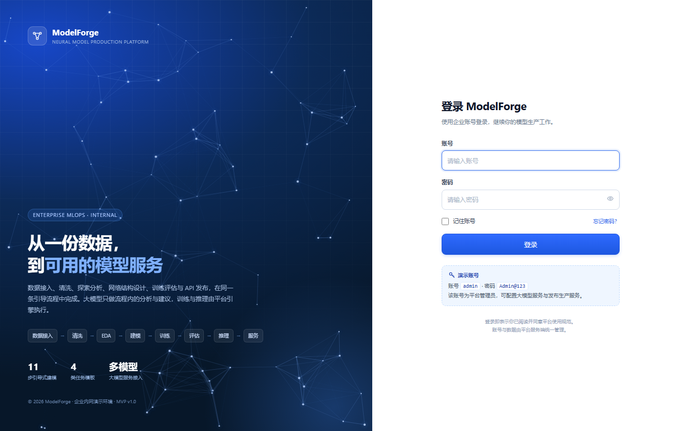
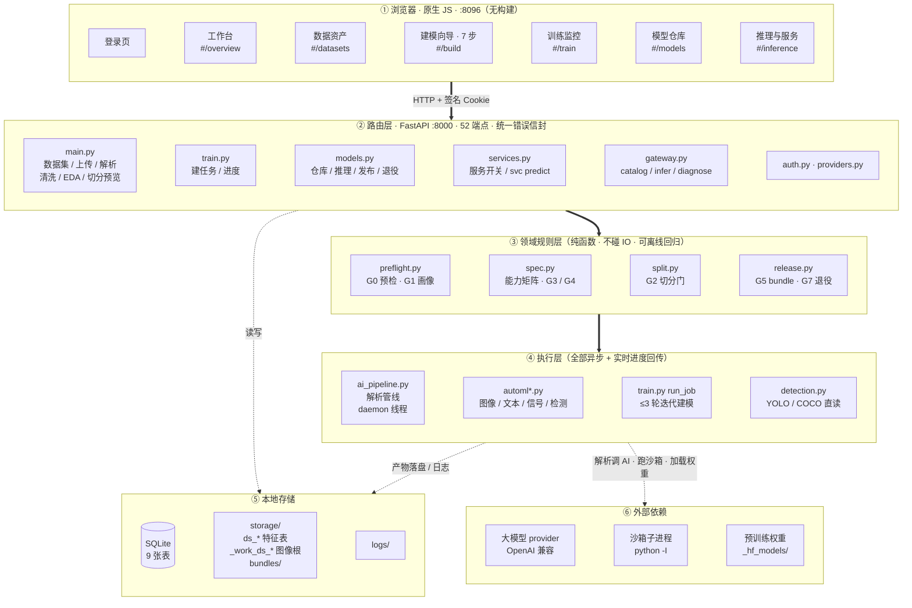
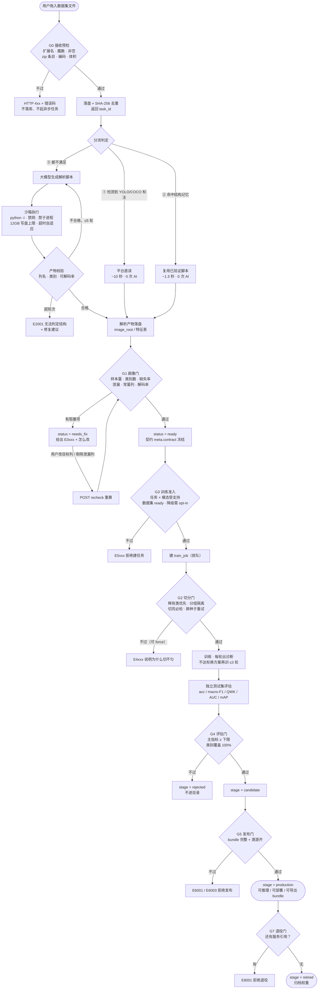
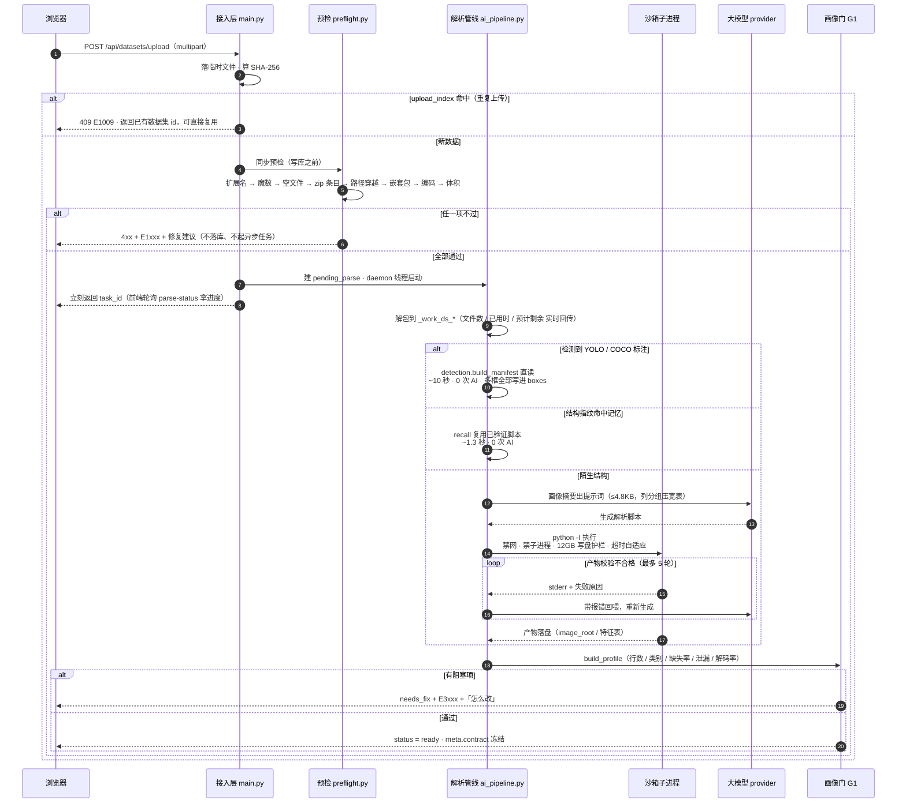
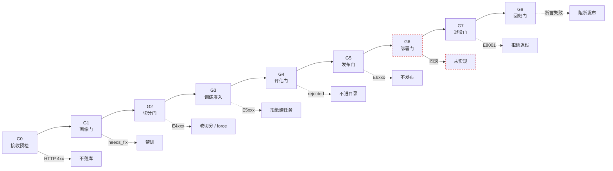
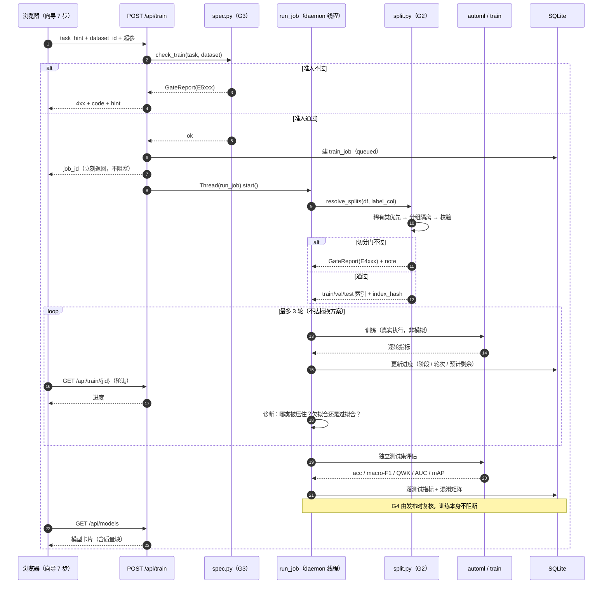
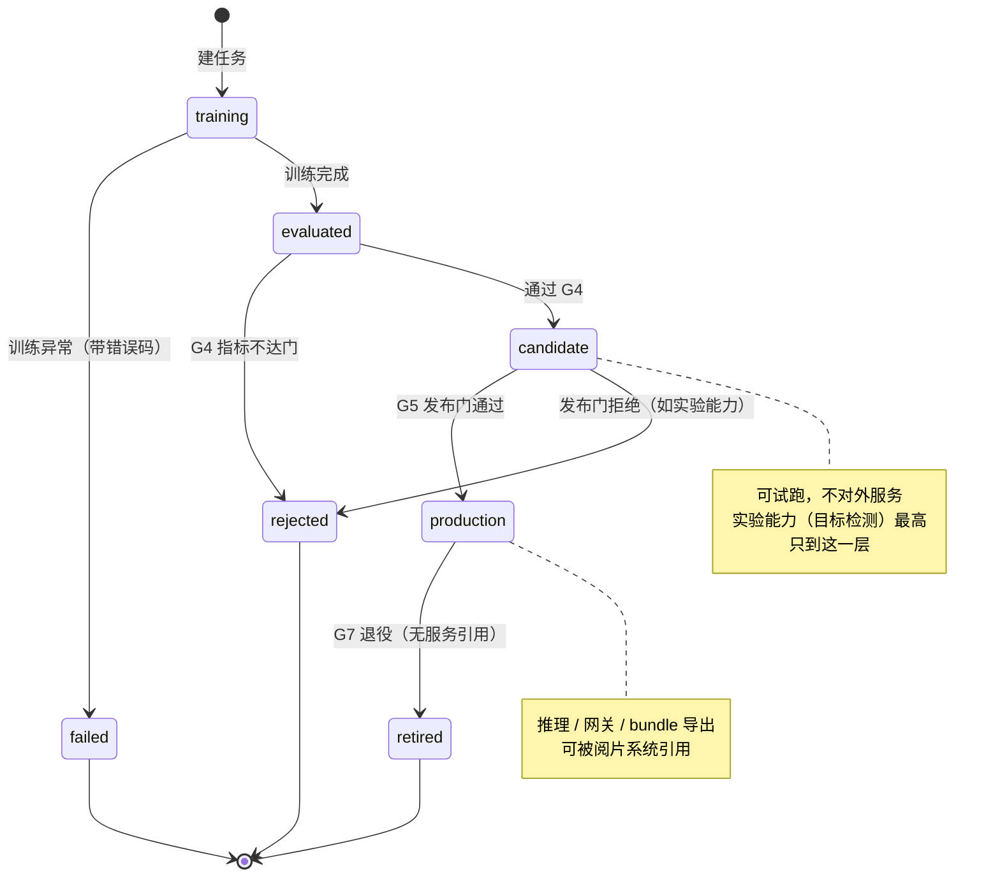
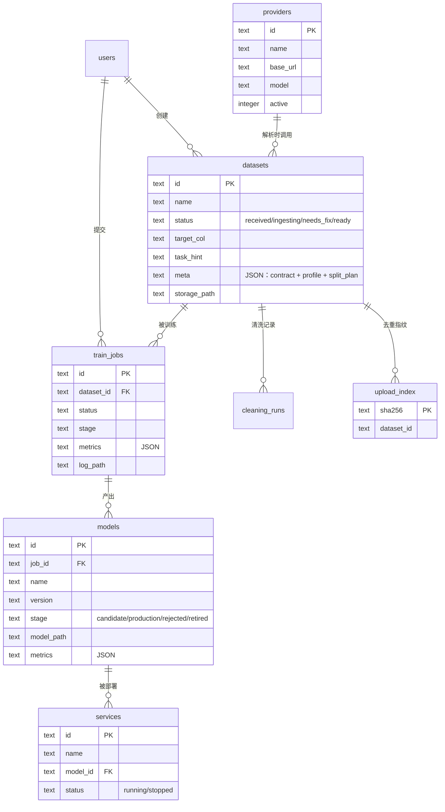
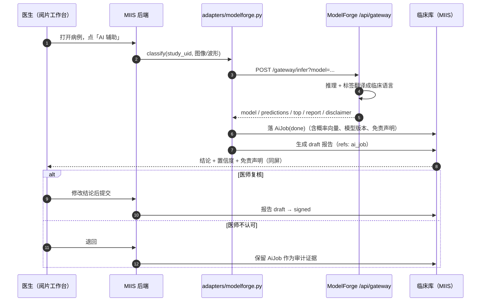

# ModelForge · 神经网络模型生产平台

> 上传一份数据，点几下鼠标，拿到一个能调用的模型。
> 中间隔着的不是「更聪明的算法」，而是 **9 道门**——每一道都会拒绝不该往下走的东西。

| | |
|---|---|
| 后端 | FastAPI + SQLite（标准库 `sqlite3`，无 ORM） |
| 前端 | 原生 JS，无构建步骤，`http.server` 直接托管 |
| 运行环境 | 单机 CPU 即可跑通图像/文本/表格/信号/检测五类任务 |
| 接口 | 52 个端点，统一错误信封（`code` / `message` / `hint` / `details`） |
| 门禁 | G0–G8，`scripts/sop_regression.py` **27 项断言**常绿 |
| 规模 | 后端 ~30 个 Python 模块、前端 11 个 JS 模块、文档 4 份 |





---

## 目录

- [0. 它到底解决什么问题](#0-它到底解决什么问题)
- [1. 系统架构图](#1-系统架构图)
- [2. 端到端流程图](#2-端到端流程图)
- [3. 上传解析：泳道图](#3-上传解析泳道图)
- [4. 九道门](#4-九道门)
- [5. 训练：时序图](#5-训练时序图)
- [6. 模型仓库与发布](#6-模型仓库与发布)
- [7. 数据模型](#7-数据模型)
- [8. 与阅片系统的一体化](#8-与阅片系统的一体化)
- [9. 项目结构](#9-项目结构)
- [10. 快速开始](#10-快速开始)
- [11. 怎么验证它没坏](#11-怎么验证它没坏)
- [12. 已知边界](#12-已知边界)
- [13. 文档索引](#13-文档索引)

---

## 0. 它到底解决什么问题

大多数「AutoML 平台」的问题是：**它们什么都能训，包括不该训的东西。**

我拿 12 个构造样本打过上传接口（`scripts/audit_upload.py`），结果是：

- 空文件、空压缩包、假 zip、路径穿越包——**7 个内容级错误全部返回 200**，报错要等异步解析才暴露；
- 更糟的是三种垃圾数据**训练「成功」**：单类别数据集训出「1 类分类器」、标签被复制成特征列（指标必然虚高）、宽表把最后一列信号当标签；
- 而结构判定强依赖大模型：大模型 401 时，连「这个包是空的」都判不出来。

所以这个项目的重点不是「更强的建模能力」，而是**拒绝的能力**：

> 平台的价值 = 能训多少 × **敢拒多少**。
> 一个会告诉你「这份数据不能训，因为第 3 条特征列和第 7 条完全同值，疑似标签泄漏」的系统，
> 比一个默默训出 0.99 准确率的系统有用得多。

改造后同一批样本：7 个内容错误全部在**同步阶段**被拒（4xx + 稳定错误码），三个垃圾数据集状态变 `needs_fix`、建任务直接被 `E5002` 拦下。逐条对比见 [§4](#4-九道门)。

---

## 1. 系统架构图

三层：浏览器（无构建原生 JS）→ FastAPI 单体（路由 / 领域规则 / 执行器）→ 本地存储与外部依赖。
**没有消息队列、没有容器编排**——单机场景下，一个进程 + 一个 SQLite 就是最合适的架构。



**为什么这么分层**

| 层 | 只做一件事 | 反例（如果不这么分） |
|---|---|---|
| 路由层 | 解析请求、校验身份、返回信封 | 业务规则散在路由里，改一条规则要翻 7 个文件 |
| 领域规则层 | 只判「过 / 不过」，不碰 IO | 门禁和训练实现耦合，想单独跑回归门就得起整个服务 |
| 执行层 | 长耗时任务，全部异步 + 进度回传 | 上传请求里同步解析 GB 级包，前端必超时 |

领域规则层是**纯函数式**的：`preflight.inspect_upload()` 只吃一个文件路径，返回 `GateReport`；
`spec.check_train()` 只吃 task + dataset 状态，返回 `GateReport`。所以回归门可以不启动服务、不连数据库，直接跑 27 项断言。

---

## 2. 端到端流程图

从「拖进去一个 zip」到「拿到一个能调的模型」，一共 6 个阶段、9 道门：



**关键点：`profiled ≠ ready`。** 解析完成只代表「数据结构读懂了」，不代表「这份数据能训」。
所有垃圾训练的上游原因，都是把这两个状态混为一谈。

---

## 3. 上传解析：泳道图

按**角色**划分泳道（每个参与者一列），纵轴是时间。看懂它就能回答「为什么上传会卡」「卡在哪一步」「错误码是谁给的」。



**三条分流路径的代价差异（实测）**

| 路径 | 触发条件 | 耗时 | AI 调用 |
|---|---|---|---|
| 检测标注直读 | 目录里有 YOLO / COCO 标注 | ~10 秒 | **0 次** |
| 结构记忆命中 | 指纹与历史数据集相似 | ~1.3 秒 | **0 次** |
| AI 生成脚本 | 以上都不满足 | 分钟级（含最多 5 轮修复） | 1–6 次 |

设计意图很直白：**能用本地规则判定的绝不用大模型**。
记忆命中率高的时候，平台用起来像本地工具；只有真正陌生的结构才付出大模型的等待时间。

沙箱的取舍也要说清：通过 `python -I` 隔离 + 守卫注入（禁网、禁子进程、写盘上限）来跑不可信代码，
**但它不是真正的安全隔离**——真正的隔离要靠容器。这里的定位是「防手滑与防死循环」，不是「防恶意攻击」。

---

## 4. 九道门



| 门 | 位置 | 拦什么 | 失败后果 | 状态 |
|---|---|---|---|---|
| **G0** 接收预检 | 同步、落盘前 | 扩展名/魔数不符、空文件、坏包、路径穿越、嵌套包、编码不可解、超体积 | HTTP 4xx，不落库 | ✅ |
| **G1** 画像门 | 解析完成后 | 样本量不足、单类别、标签泄漏、缺失率过高、常量列、解码失败率 | `needs_fix`，禁止训练 | ✅ |
| **G2** 切分门 | 训练前 | 测试集为空、分组泄漏、训练集缺类、稀有类被垄断 | 拒绝或需 `force` | ✅ |
| **G3** 训练准入 | 建任务时 | 任务×模态不支持、数据集未 ready、降级未显式开启 | 拒绝建任务 | ✅ |
| **G4** 评估门 | 训练完成 | 主指标未达下限、无测试集、类别未全覆盖 | `rejected` | ✅ |
| **G5** 发布门 | 发布时 | bundle 不完整、溯源缺失、实验能力（检测） | 拒绝发布 | ✅ |
| **G6** 部署门 | 部署时 | 端口、健康检查、入参 schema 一致性 | 回滚 | ⚠️ 未实现 |
| **G7** 退役门 | 退役时 | 仍有服务引用 | 拒绝退役 | ✅ |
| **G8** 回归门 | 每次改门禁 | 审计样本必须按预期拦截，真实数据集不得误伤 | 阻断发布 | ✅ 27 项 |

### 拦截证据（12 个审计样本，真实执行）

| 样本 | 改造前 | 改造后 |
|---|---|---|
| `empty.csv` | 200 → pandas `Could not determine delimiter` | **400 `E1003`** |
| `header_only.csv` | 200 →「表格文件内容为空」 | **400 `E1003`** |
| `utf16_semicolon.csv` | 200 → `'utf-8' codec can't decode` | **解析成功**（随后被 G1 以样本量不足拦下） |
| `fake.zip` | 200 → `File is not a zip file` | **400 `E1002`** |
| `traversal.zip` | 200 → 后台才拦 | **400 `E1006`** |
| `empty.zip` | 200 → 大模型 401 | **400 `E1007`** |
| `nested.zip` | 200 → 大模型 401 | **400 `E1008`** |
| `images_no_labels.zip` | 200 → 大模型 401 | **本地诊断**：缺标签来源 + 修复指引 |
| `archive.rar` | 400 泛化提示 | **400 `E1001`** 带支持列表 |
| `single_class.csv` | 训练「成功」，产出 1 类分类器 | **`needs_fix`**，拒绝建任务 |
| `target_leak.csv` | 训练「成功」，指标虚高 | **`needs_fix` `E3004`** |
| `wide_no_target.csv` | 训练「成功」（把 `s299` 当标签） | **`needs_fix` `E3001`** |

错误码分段：`10` 接收 / `20` 解析 / `30` 画像 / `40` 切分 / `50` 训练 / `60` 发布 / `70` 部署 / `80` 退役。
完整清单见 [docs/SOP.md §6](docs/SOP.md)。

---

## 5. 训练：时序图



**迭代策略**（不是「多训几轮」这么简单）：

1. 第一轮先跑一个保守方案（小尺寸、浅层微调），拿到基线；
2. 每轮结束出**诊断**：看每类 F1、看训练/验证曲线差、看混淆矩阵里谁被谁吃掉；
3. 诊断结果决定下一轮动什么——加容量、提分辨率、改增强、换主干；
4. 全部轮次结束取**最佳**，不是取最后一轮。

> 踩过的坑：早期版本「第 2/3 轮原样重跑」，白烧 25 分钟，指标纹丝不动。现在每轮必须基于上一轮方案递进，否则不启动下一轮。

---

## 6. 模型仓库与发布



一个「模型」不是一个裸权重文件，而是一个**可独立部署的目录**：

```
model_bundle/
├── manifest.json        # bundle_version, model_id, name, version, task, modality, created_at
├── weights.pt           # state_dict
├── preprocess.json      # 归一化参数、图像尺寸、信号采样率、分词器版本
├── labels.json          # {"classes": [...], "order": "sorted", "thresholds": {...}}
├── input_schema.json    # 推理入参：字段名 / 类型 / 形状 / 单位
├── metrics.json         # 测试集指标 + 每类指标 + 混淆矩阵
├── provenance.json      # dataset_id/version, job_id, split_strategy, 随机种子, 代码版本
└── card.md              # 模型卡：用途、限制、训练数据、免责声明
```

`provenance.json` 缺失 → `E6001`；`metrics.json` 里没有 test 段 → `E6003`。
**没有溯源就没有模型**——这是「客户问『这个 0.87 是怎么来的』时能不能答上来」的分界线。

---

## 7. 数据模型

9 张表，全部在 `backend/db.py` 里用标准库 `sqlite3` 建。



几个刻意的选择：

- **`meta` 用 JSON 存契约**，不拆表——契约会演进（v2 加 `contract_version`），拆表就得次次迁移；
- **`upload_index` 独立成表**，只存 SHA-256 → dataset_id，上传时一次查询就能去重，不用扫整个 datasets；
- **`stage` 是字符串而不是布尔**，因为「拒绝」和「归档」是两种不同的不可用，混成一个 `is_active` 会丢信息。

---

## 8. 与阅片系统的一体化

训练平台不写临床库，阅片系统（MIIS）不碰训练。中间靠 `gateway.py` 的一个薄适配层连接：



三条硬边界：

1. **网关只产出建议性结论**，不写临床库、不签发报告；
2. **报告固定 `draft` 态**，必须医师复核后提交——AI 不能签字；
3. **`diagnose` 的 `context` 只进结论文本、不进模型输入**，避免患者信息喂进模型造成偏倚。

---

## 9. 项目结构

```
nn-studio-mvp/
├── backend/                        FastAPI 单体
│   ├── main.py                     数据集 / 上传 / 解析 / 清洗 / EDA / 切分预览（22 端点）
│   ├── auth.py                     登录、会话、首次启动建管理员
│   ├── db.py                       SQLite 全部读写（9 张表）
│   ├── preflight.py                G0 预检 + 画像 G1 + 数据集契约
│   ├── spec.py                     能力矩阵、G3 训练准入、G4 评估门
│   ├── split.py                    G2 切分门：稀有类优先 / 分组隔离 / 切完必检
│   ├── release.py                  G5 bundle、发布、G7 退役
│   ├── ai_pipeline.py              异步解析管线：分流 → 生成 → 沙箱 → 迭代
│   ├── llm.py                      大模型调用、结构画像、提示词
│   ├── recall.py · fingerprint.py  结构记忆库与指纹
│   ├── detection.py                YOLO / COCO 直读（含分割多边形转框）
│   ├── automl.py                  智能体建模：图像分类
│   ├── automl_text.py             文本分类
│   ├── automl_signal.py           1D 信号（12 导联 ECG）
│   ├── automl_detect.py           目标检测（YOLOv8）
│   ├── train.py                    训练主流程、run_job、诊断
│   ├── models.py                   模型仓库 / 推理 / bundle / 发布 / 退役（11 端点）
│   ├── services.py                 服务开关与 svc predict（6 端点）
│   ├── gateway.py                  对外网关：catalog / infer / diagnose（3 端点）
│   ├── providers.py                大模型服务配置（5 端点）
│   ├── analysis.py                 列统计与任务推断
│   ├── storage/                    ds_* 特征表 · _work_ds_* 图像根 · bundles/
│   └── _hf_models/                 预训练权重本地缓存
├── frontend/                       原生 JS，无构建
│   ├── index.html · login.html
│   └── assets/
│       ├── api.js                  统一请求封装（401 自动跳登录）
│       ├── base.js                 组件、图表、样式变量
│       ├── core.js                 hash 路由、导航、工作台
│       ├── data.js                 数据资产、上传、解析进度
│       ├── parse-plans.js          解析报告与画像门结论
│       ├── wizard.js               建模向导（7 步）
│       ├── wizard-run.js           训练监控与结果
│       ├── models.js               模型仓库、bundle、发布
│       └── ops.js                  推理与服务
├── docs/                           SOP / API / CONTRACT / PRD
├── experiments/                    Day 0–7 实测记录与原始指标 JSON
├── scripts/
│   ├── audit_upload.py             12 个坏样本的体检脚本
│   ├── sop_regression.py           回归门：27 项断言
│   ├── e2e_integration.py          与阅片系统的端到端联调
│   ├── run_chain.py · retrain.py   批量跑链 / 重训
│   └── report_job.py               训练报告导出
├── start.py                        启动器（检测端口、清理旧进程）
└── README.md
```

---

## 10. 快速开始

### 环境要求

- Python 3.13+（开发环境 3.14.7）
- 依赖：`fastapi` `uvicorn` `pandas` `numpy` `torch` `torchvision` `pillow` `transformers` `scikit-learn` `ultralytics`
- 至少一个可用的大模型服务（OpenAI 兼容接口），用于 AI 解析与建模决策

### 启动

```bash
# 方式一：启动器（推荐，自动检测端口占用并清理旧进程）
python start.py

# 方式二：分别启动
cd backend && python -m uvicorn main:app --host 127.0.0.1 --port 8000 --log-level warning
cd frontend && python -m http.server 8096 --bind 127.0.0.1

# 停止
python start.py --stop
```

### 访问

| 入口 | 地址 |
|---|---|
| 平台页面 | http://127.0.0.1:8096/index.html |
| 后端 API | http://127.0.0.1:8000 |
| 默认账号 | `admin`（密码取环境变量 `NN_ADMIN_PASSWORD`，未设置则为开发默认口令） |

> 生产部署务必设置 `NN_ADMIN_PASSWORD`，否则任何知道默认口令的人都能登录管理后台。

### 支持的数据类型

| 任务 | 模态 | 建模方式 | 主指标 / 下限 |
|---|---|---|---|
| 图像分类 | 图像 | 微调 MobileNetV3 / ResNet18 | macro-F1 ≥ 0.60 |
| 图像分级 | 图像 | 同上 + 有序约束 | QWK ≥ 0.60 |
| 文本分类 | 文本 | 预训练句向量 + 训头 | macro-F1 ≥ 0.60 |
| 表格分类 | 表格 | HistGradientBoosting | macro-F1 ≥ 0.60 |
| 表格回归 | 表格 | HistGradientBoosting | R² ≥ 0.30 |
| 信号分类 | 1D 信号 | 1D CNN + 逐类阈值标定 | macro-AUC ≥ 0.70 |
| 目标检测 | 图像 + 框 | YOLOv8n（仅实验，不可发布） | mAP ≥ 0.25 |

**文件格式**：归档 `zip` `tar` `tar.gz` `tgz`（单文件 ≤ 3GB）；表格 `csv` `tsv` `txt` `xlsx` `xls` `json` `jsonl` `parquet`；
图像 `jpg` `jpeg` `png` `bmp` `webp` `tif`；标注 YOLO 检测框 / YOLOv8 分割多边形 / COCO JSON。

---

## 11. 怎么验证它没坏

门禁这种东西，最容易「改一个规则，悄悄放过一类坏数据」。所以它自带回归门：

```bash
cd nn-studio-mvp
./.venv/Scripts/python.exe scripts/sop_regression.py
```

```
[G0] 接收预检 ............ 9 项
[G1] 画像门 .............. 3 项
[G3] 训练准入 ............ 4 项
[G4] 发布门 .............. 4 项
[G8] 真实数据集不得误伤 ... 2 项
全部通过（27/27）
```

回归门做两件事：

1. **坏输入必须按预期拦截**——每个断言都写明「这个样本应该返回哪个错误码」，改了错误码就红；
2. **真实数据集不得误伤**——眼底 DR 五级与肺炎筛查集必须仍能过画像门，防止「为了拦坏数据把好数据也拦了」。

想复现审计结论，可以直接跑体检脚本（需要服务在 8000 端口）：

```bash
python scripts/audit_upload.py          # 生成 12 个坏样本并逐个上传
python scripts/audit_upload.py --keep    # 保留样本目录，便于人工核对
```

---

## 12. 已知边界

这一节不写「未来规划」，只写**现在做不到什么**。

| # | 边界 | 影响 |
|---|---|---|
| 1 | **G6 部署门未实现** | 「服务」是数据库里的逻辑开关 + 进程内推理路由，不是真实容器；没有 `/healthz` 与金丝雀推理 |
| 2 | **训练不消费「已确认的切分方案」** | `split-plan:apply` 存的方案只是记录；训练侧每次按默认种子重算，参数不变时一致，但不会读你确认过的那份 |
| 3 | **前端未展示错误码与 `hint`** | 后端已经把 `code`/`hint`/`details` 返回了，页面仍显示原始 `message`，用户看不到「该改什么」 |
| 4 | **规范超前于实现的两处** | SOP 要求「分级 ≥300 张」「多标签信号 ≥500 条」，代码统一按 100 / 300 卡，没做单独下限 |
| 5 | 单机 CPU | YOLO 训练 717 张约 5 分钟；12 万条文本编码约 30 分钟 |
| 6 | 分割标注降级为检测框 | YOLOv8 分割多边形转最小外接矩形，精度不如原生 YOLO-seg |
| 7 | 训练无并发上限 | 多个训练同时跑会互相抢 CPU |
| 8 | 无断点续训 | YOLO 训练中断需重来 |
| 9 | 沙箱不是安全边界 | `python -I` + 守卫只防手滑与死循环，不防恶意代码 |

### 环境踩坑（都是真实遇到的）

- HuggingFace 直连不通：设 `HF_ENDPOINT=https://hf-mirror.com`；transformers 自动下载可能拿到 0 字节文件，应手动 curl 到 `backend/_hf_models/`。
- `python -I` 沙箱**不能加 `-S`**（会禁用 site-packages，pandas 直接导入失败）。
- `backend/storage/_work_ds_*` 是解析出的实际图像文件，被 `datasets.meta.image_root` 引用，**删了会导致训练时全部解码失败**。
- SQLite 在部分 Windows 盘符下 WAL 模式报只读，已改 `DELETE` 模式 + 长 `busy_timeout`。

---

## 13. 文档索引

| 文档 | 内容 |
|---|---|
| [docs/SOP.md](docs/SOP.md) | **规范**：九道门定义、错误码全表、能力矩阵、模型包契约、实现映射与未落地清单 |
| [docs/API.md](docs/API.md) | 接口文档：端点、请求/响应示例、错误信封 |
| [docs/CONTRACT.md](docs/CONTRACT.md) | 平台 ↔ 大模型契约：产物 schema、划分规则、沙箱约束 |
| [docs/PRD.html](docs/PRD.html) | 产品需求文档：背景、范围、对象模型、页面规格 |
| [experiments/项目实测报告.md](experiments/项目实测报告.md) | Day 0–7 实测：眼底分级 QWK 0.817、PTBXL AUC 0.881、MIT-BIH 数据饥饿、门禁改造复测 |
| [experiments/day6-integration.md](experiments/day6-integration.md) | 与阅片系统打通的实现细节与两个推理层缺陷 |

---

## 设计原则（写在代码注释里，也写在这里）

1. **契约先行** —— 每个产物都有显式 schema；跨阶段只认 schema，不认约定。
2. **门禁式推进** —— 阶段之间是门，不是流水线；不满足准入就不进下一阶段。
3. **失败必须可解释** —— 每个拒绝都有稳定错误码 + 人话 + 可执行建议。
4. **确定性优先于智能** —— 能用本地规则判定的，绝不用大模型；大模型只做语义补全。
5. **不做静默降级** —— 降级必须显式开启并留痕，且产物标记为 degraded。

---

## 许可

本项目为演示与工程参考实现，未申请医疗器械注册。任何临床用途需按相应法规独立评估。
