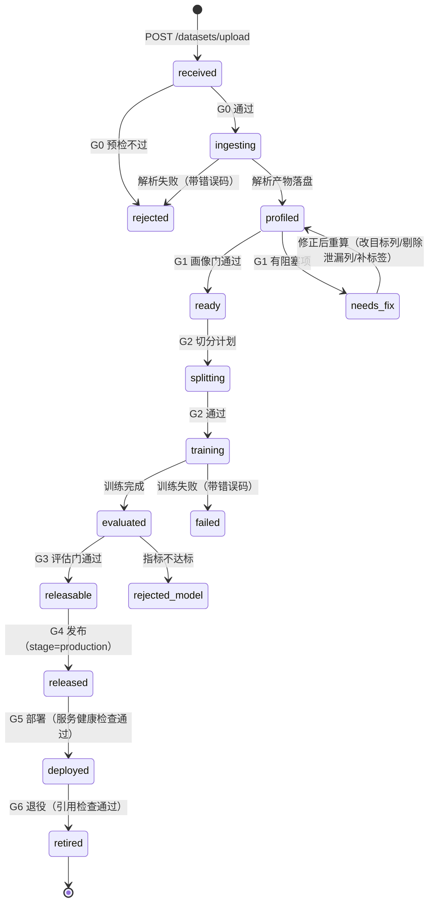

# ModelForge 数据到模型全流程 SOP（v2 重构版）

> 本文是**规范**，不是说明书。代码实现必须服从本文；本文没有规定的行为，一律视为「未定义」，
> 未定义的行为不允许出现在生产路径上。
>
> 版本：2.0-rc1 · 编写依据：2026-10-30 上传链路审计（`scripts/audit_upload.py`）

---

## 0. 为什么要重做：现状审计结论

用 11 个构造样本打现有接口，结果如下（全部真实执行，非推测）：

| 样本 | 现状表现 | 本质问题 |
|---|---|---|
| `empty.csv` | 接口 200 → 后台 `Could not determine delimiter` | 空文件没有在接收层被识别，把 pandas 内部错误抛给用户 |
| `header_only.csv` | 200 → 「表格文件内容为空」 | 同上，错误发生得太晚 |
| `utf16_semicolon.csv` | 200 → `'utf-8' codec can't decode 0xff` | 无编码嗅探，UTF-16/GBK 系文件直接失败 |
| `fake.zip` | 200 → `File is not a zip file` | 无魔数校验 |
| `empty.zip` | 200 → **大模型 401** | 空包本可本地判定，却被送去大模型；大模型不可用即全链路失败 |
| `images_no_labels.zip` | 200 → **大模型 401** | 同上：结构判定强依赖大模型，无本地兜底 |
| `nested.zip` | 200 → **大模型 401** | 同上 |
| `traversal.zip` | 200 → 后台拦截 | 拦得对，但**接口返回 200**，调用方以为成功 |
| `archive.rar` | 400 扩展名不支持 | 唯一在同步阶段被拒的类别 |
| `single_class.csv` | **200 → 解析完成 → 训练完成** | 单类别仍建成分类任务，产出 1 类分类器 |
| `target_leak.csv` | **200 → 解析完成 → 训练完成** | 标签被复制成特征列，指标必然虚高 |
| `wide_no_target.csv` | **200 → 解析完成 → 训练完成**（把 `s299` 当标签） | 目标列「取最后一列」兜底，把信号当标签 |

三条结论：

1. **接口返回 200 不代表成功**。所有内容级错误都在异步解析里才暴露，用户只看到一句「上传失败」，
   拿不到错误码、拿不到定位、也不知道该改什么。
2. **解析强依赖大模型**。空包、无标签图像这类纯结构化判定也走大模型，模型 401 时
   连「这个包是空的」都判不出来。这是「数据集上传失败、各种原因」的最大单一来源。
3. **没有准入门，什么都敢训**。单类别、标签泄漏、把信号列当标签——三种垃圾数据全部训练「成功」。
   平台缺少的不是训练能力，而是**拒绝训练的能力**。

---

## 1. 设计原则

| # | 原则 | 含义 | 反面（现状） |
|---|---|---|---|
| P1 | **契约先行** | 每个产物（数据集/模型/服务）都有显式 schema；跨阶段只认 schema，不认约定 | 靠 `meta_json` 里随手塞 key |
| P2 | **门禁式推进** | 阶段之间是门，不是流水线；不满足准入就不进下一阶段 | 解析失败也算 200，训练随便点 |
| P3 | **失败必须可解释** | 每个拒绝都有稳定错误码 + 人话 + 可执行建议 | 「解析异常：…」堆栈文本 |
| P4 | **确定性优先于智能** | 能用本地规则判定的，绝不用大模型；大模型只做语义补全 | 空 zip 也去调 LLM |
| P5 | **不做静默降级** | 降级必须显式开启并留痕，且产物标记为 degraded | 自动建模失败偷偷退基础路径 |

---

## 2. 生命周期状态机



关键：`profiled` 不等于 `ready`。现状把「解析完成」直接当「可以训练」，这是所有垃圾训练的上游原因。

---

## 3. 九道门

| 门 | 位置 | 输入 | 通过条件 | 失败后果 |
|---|---|---|---|---|
| G0 接收预检 | 同步、写入存储前 | 上传字节流 | 扩展名 + 魔数一致、非空、zip 可读且条目合法、编码可解、未超限 | **HTTP 4xx**，不落库、不起后台任务 |
| G1 画像门 | 解析完成后 | 数据集 profile | 行数/类别数/缺失率/泄漏/常量列/可解码率达标 | 数据集 `status=needs_fix`，禁止训练 |
| G2 切分门 | 训练前 | 切分计划 | 测试集非空；分组切分无跨组泄漏；类别在训练集全覆盖 | 拒绝建任务 |
| G3 训练准入 | 建任务时 | task_hint + 能力矩阵 | 任务×模态受支持；数据集 `ready`；降级需显式 opt-in | 拒绝建任务（`E5xxx`） |
| G4 评估门 | 训练完成 | 指标 JSON | 主指标 ≥ 任务下限；测试集存在；类别覆盖 100% | 模型 `stage=rejected`，不进目录 |
| G5 发布门 | 发布时 | 模型包 | bundle 完整（权重+预处理+标签表+schema+溯源）；溯源指向 job/dataset | 拒绝发布 |
| G6 部署门 | 部署时 | 服务描述 | 端口可用；健康检查 200；输入 schema 与模型包一致 | 部署失败并回滚 |
| G7 退役门 | 退役/删除时 | 引用图 | 无服务引用；或已指定替代模型 | 拒绝退役 |
| G8 回归门 | 每次改模型/SOP | 固定回归集 | 审计样本全部按预期拦截，主线数据集不误伤 | 阻断发布 |

---

## 4. 数据集契约

落库记录除现有字段外，必须包含 `meta.contract`：

```json
{
  "contract_version": "2.0",
  "kind": "tabular | image | text | signal | detection",
  "task": "tabular_classification",
  "target": "label",
  "features": ["age", "sex"],
  "classes": ["0_healthy", "1_mild"],
  "class_counts": {"0_healthy": 1200, "1_mild": 300},
  "split": {"train": 1200, "val": 300, "test": 413, "strategy": "patient_group"},
  "profile": {
    "rows": 1913, "cols": 12,
    "missing_pct": 0.004, "duplicate_rows": 3,
    "constant_cols": ["hospital_id"],
    "leak_suspects": [],
    "decode_fail_pct": 0.0
  },
  "gate": {"status": "ready", "codes": [], "checked_at": "..."}
}
```

规则：

- `target` 必须显式确定，**禁止「取最后一列」兜底**。AI 与规则都给不出时，判 `needs_fix` 并请用户指定。
- `classes` 与 `class_counts` 必须来自同一份数据快照，且与训练时 `sorted()` 顺序一致（沿用现有约束）。
- `split.strategy` 必须记录：`given` / `random_stratified` / `group`；`group` 时记录分组键列名。
- `profile` 一旦生成即冻结；数据变更走新版本（`v2`），不允许原地改 profile。

---

## 5. 能力矩阵

「支持」= 走完整九道门；「实验」= 允许训练但不得发布（`stage` 最高 `staging`）；空格 = 拒绝。

| 任务 | 模态 | 最小样本 | 类别要求 | 主指标 / 下限 | 可发布 |
|---|---|---|---|---|---|
| `image_classification` | 图像 | 100 张 | ≥2 类，每类 ≥10 | macro-F1 ≥ 0.60 | ✅ |
| `image_classification`（分级） | 图像 | 300 张 | 有序 ≥3 级 | QWK ≥ 0.60 | ✅ |
| `tabular_classification` | 表格 | 100 行 | 2–200 类 | macro-F1 ≥ 0.60 | ✅ |
| `tabular_regression` | 表格 | 100 行 | 目标方差 > 0 | R² ≥ 0.30 | ✅ |
| `text_classification` | 文本 | 200 行 | ≥2 类，平均长度 ≥10 字符 | macro-F1 ≥ 0.60 | ✅ |
| `signal_classification` | 信号 | 300 条 | ≥2 类（多标签则每标签 ≥30） | macro-AUC ≥ 0.70 | ✅ |
| `signal_classification`（多标签） | 信号 | 500 条 | 每标签 ≥30 正例 | macro-AUC ≥ 0.70 | ✅ |
| `object_detection` | 图像+框 | 100 张 | ≥1 类，框合法率 ≥95% | mAP ≥ 0.25 | ⚠️ 实验 |
| 表格列数 > 2000 | 表格 | — | — | — | ❌ 引导转向信号/降维 |

强制约束：

- **单类别分类一律拒绝**（`E3201`），不做「1 类分类器」。
- **目标列与任一特征列完全同值 → 阻塞**（`E3204`，标签泄漏）。
- **表格列数 > 2000 且无目标列 → 阻塞**并提示：若为时序/信号，请声明 `signal_classification` 并提供导联列。

---

## 6. 错误码

格式：`E<阶段><3位序号>`。前两位是阶段：10=接收、20=解析、30=画像、40=切分、50=训练、60=发布、70=部署、80=退役。`W` 前缀为警告，不阻断。

### 接收（同步返回 4xx）

| 码 | HTTP | 含义 | 建议 |
|---|---|---|---|
| `E1001` | 400 | 扩展名不支持 | 列出支持列表 |
| `E1002` | 400 | 内容与扩展名不符（魔数校验失败） | 检查是否改过后缀 |
| `E1003` | 400 | 文件为空（0 字节） | 重新导出 |
| `E1004` | 413 | 超过体积上限 | 分卷或降采样 |
| `E1005` | 400 | 压缩包损坏 | 重新压缩 |
| `E1006` | 400 | 压缩包含非法路径（穿越/绝对路径） | 移除可疑条目 |
| `E1007` | 400 | 压缩包为空 | 检查打包目录层级 |
| `E1008` | 400 | 压缩包内嵌套压缩包 | 先解一层再上传 |
| `E1009` | 409 | 内容重复（SHA-256 命中已有数据集） | 返回已有数据集 id，可直接复用 |
| `E1010` | 400 | 编码无法识别 | 转 UTF-8 后重传 |

### 解析 / 画像 / 训练 / 发布 / 部署 / 退役

| 码 | 含义 |
|---|---|
| `E2001` 无法判定数据集结构（本地规则与大模型均失败） |
| `E2002` 图像无法解码（抽样失败率超阈值） |
| `E2003` 找不到标签来源（无 label 列且目录名不含类别） |
| `E3001` 目标列未确定 |
| `E3002` 样本量不足 |
| `E3003` 类别数不满足要求（含单类别） |
| `E3004` 标签泄漏 |
| `E3005` 缺失率过高 |
| `E3006` 目标列方差为 0 |
| `E4001` 测试集为空 |
| `E4002` 分组切分存在跨组泄漏 |
| `E5001` 任务×模态不受支持 |
| `E5002` 数据集未就绪 |
| `E5003` 降级训练未显式开启 |
| `E6001` 模型包不完整 |
| `E6002` 主指标未达下限 |
| `E6003` 缺少测试集评估 |
| `E7001` 健康检查失败 |
| `E8001` 仍有服务引用 |

---

## 7. 模型包契约（bundle）

模型不再是一个裸 `.pt`，而是一个可独立部署的目录/zip：

```
model_bundle/
  manifest.json        # bundle_version, model_id, name, version, task, modality, created_at
  weights.pt           # state_dict
  preprocess.json      # 归一化参数、图像尺寸、信号采样率、分词器版本
  labels.json          # {"classes": [...], "order": "sorted", "thresholds": {...}}
  input_schema.json    # 推理入参：字段名/类型/形状/单位
  metrics.json         # 测试集指标 + 每类指标 + 混淆矩阵
  provenance.json      # dataset_id/version, job_id, split_strategy, 随机种子, 代码版本
  card.md              # 模型卡：用途、限制、训练数据、临床免责
```

`provenance.json` 缺失 → `E6001`；`metrics.json` 中无 test 段 → `E6003`。

---

## 8. 部署与运行契约

- 服务只能加载**已发布**（`stage=production`）的模型；`candidate` 仅限沙箱试用。
- 每个服务启动后必须通过 `/healthz` 与一次**金丝雀推理**（用 bundle 内自带的 `smoke_input`）；不通过即回滚。
- 服务描述记录：`model_id`、`bundle_hash`、`port`、`replicas`、`started_at`。
- 退役顺序：摘流量 → 停服务 → `stage=retired` → 归档权重；任一步失败即回滚，不允许跳步。

---

## 9. 接口变更

| 方法 | 路径 | 说明 |
|---|---|---|
| POST | `/api/datasets/upload` | **同步预检**；失败返回 4xx + `code`；成功返回 `task_id` |
| GET | `/api/datasets/{id}/profile` | 返回 contract（含 profile 与 gate） |
| POST | `/api/datasets/{id}/recheck` | 修正目标列/剔除列后重算画像门 |
| POST | `/api/datasets/{id}/split-plan` | 生成并校验切分计划（G2） |
| POST | `/api/train` | 增加 G3：能力矩阵 + 就绪校验，失败返回 `E5xxx` |
| GET | `/api/models/{id}/bundle` | 下载模型包 zip |
| POST | `/api/models/{id}:release` | G5 发布门，通过后 `stage=production` |
| POST | `/api/models/{id}:retire` | G7 退役门，引用检查 |

错误响应统一信封（与 MIIS 契约一致）：

```json
{"error": {"code": "E3204", "message": "目标列与特征列 label 完全同值，疑似标签泄漏",
           "hint": "请删除该特征列或改选目标列后重试",
           "details": {"column": "label", "duplicate_of": "label_copy"}}}
```

---

## 10. 迁移与验收

**阶段化迁移**（不一次性重写，避免主线断掉）：

1. **M1 接收层**：G0 预检 + 错误信封。验收：审计 11 样本中，7 个内容类错误全部在同步阶段被拒且带正确错误码。
2. **M2 画像层**：G1 + contract 落库。验收：单类别、标签泄漏、宽表无目标三类样本 `status=needs_fix`。
3. **M3 训练门**：G3。验收：对 `needs_fix` 数据集建任务返回 `E5002`；未声明降级时返回 `E5003`。
4. **M4 模型包**：G5 + bundle。验收：DR/PTBXL/MIT-BIH 三个模型均可导出并通过 `provenance` 校验。
5. **M5 发布/退役**：G4/G6/G7。验收：指标不达标模型无法发布；被服务引用的模型无法退役。

**回归门（G8）**：`scripts/audit_upload.py` 与 `scripts/sop_regression.py` 必须常绿；
任何一次 SOP 改动都要重跑，坏输入拦截率 100%，三个真实数据集不误伤。

---

## 11. 实现映射（v2.0-rc1 已落地部分）

| 规范 | 代码 | 状态 |
|---|---|---|
| 能力矩阵 / G1 / G3 / G4 规则 | `backend/spec.py` | ✅ |
| G0 预检 / 画像 / 契约 | `backend/preflight.py` | ✅ |
| G5 模型包 / 发布 / G7 退役 | `backend/release.py` | ✅ |
| 上传同步预检 + 错误信封 | `backend/main.py` | ✅ |
| 训练准入 | `backend/train.py` | ✅ |
| 模型包与发布/退役接口 | `backend/models.py` | ✅ |
| 归档/拒绝态不进目录、不提供推理 | `backend/db.py`、`backend/gateway.py` | ✅ |
| 编码嗅探（UTF-16/GBK） | `ai_pipeline.py`、`llm.py` | ✅ |
| 压缩包本地结构诊断（不依赖大模型） | `ai_pipeline._diagnose_archive` | ✅ |
| 上传去重（SHA-256） | `db.upload_index` | ✅ |
| 回归门 | `scripts/sop_regression.py`（28 项断言） | ✅ |

**审计样本复测（改造后）**

| 样本 | 改造前 | 改造后 |
|---|---|---|
| empty.csv | 200 → pandas 报错 | **400 E1003** |
| header_only.csv | 200 → 「内容为空」 | **400 E1003** |
| utf16_semicolon.csv | 200 → utf-8 解码失败 | **解析成功**（画像门 E3002 因样本不足） |
| fake.zip | 200 → not a zip | **400 E1002** |
| traversal.zip | 200 → 后台才拦 | **400 E1006** |
| empty.zip | 200 → 大模型 401 | **400 E1007** |
| nested.zip | 200 → 大模型 401 | **400 E1008** |
| images_no_labels.zip | 200 → 大模型 401 | **本地诊断**：缺标签来源 + 修复指引 |
| archive.rar | 400 泛化提示 | **400 E1001** 带支持列表 |
| single_class.csv | 训练「成功」 | **needs_fix E3002/E3003**，拒绝建任务 |
| target_leak.csv | 训练「成功」 | **needs_fix E3002/E3004**，拒绝建任务 |
| wide_no_target.csv | 训练「成功」 | **needs_fix E3001/E3002/E3004**，拒绝建任务 |

**发布门实测**

| 模型 | 结果 |
|---|---|
| 眼底DR五级-DAY2 | production（macro-F1 0.652 / QWK 0.817） |
| PTBXL 12 导联信号路径 | production（macro-AUC 0.881） |
| MITBIH 信号路径 DAY5 | rejected（macro-F1 0.456，F 类几乎识别不出） |
| 肺炎筛查模型 | 拒绝发布（无独立测试集指标）；因被服务引用，保持 candidate 不自动降级 |

**尚未落地（下一阶段）**

- G2 切分门尚未独立成门（切分一致性检查仍在 `ai_pipeline` 内部，未暴露 `split-plan` 接口）。
- G6 部署门：服务启动后的金丝雀推理未实现。
- 前端尚未展示错误码与画像门结论（后端已提供，页面仍显示原始 message）。

